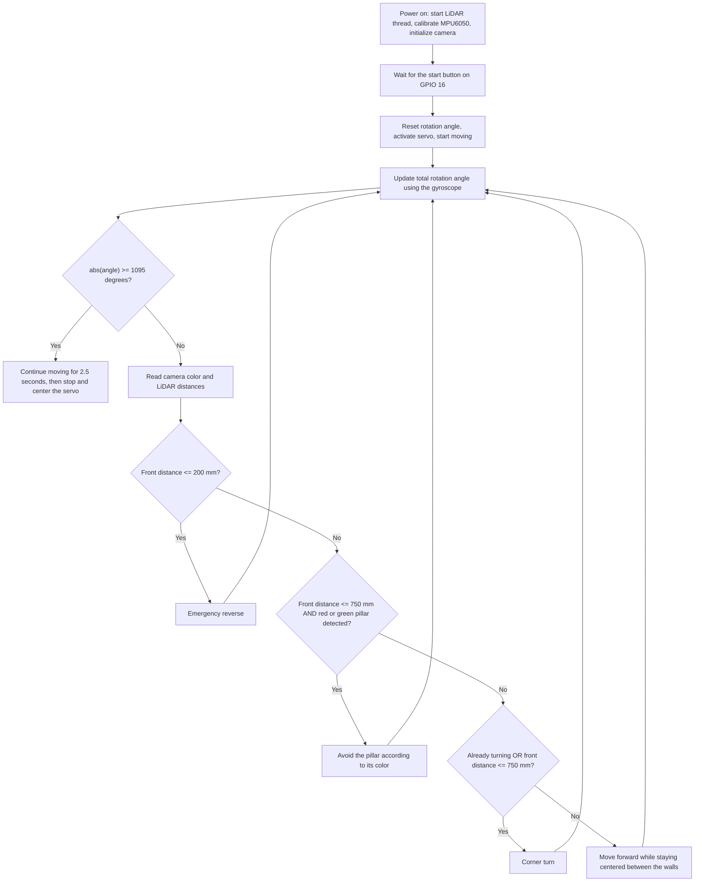
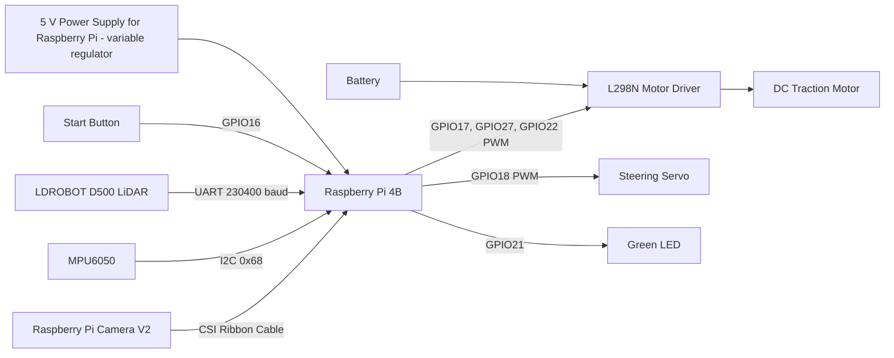

 <h1 align="center"> Tereneitor_RAB | Future Engineers | Puerto Rico🚀</h1>
<br>

<div align="center">

<table>
  <tr>
    <td width="50%" align="center" valign="top">
      
    </td>
    <td width="50%" valign="top">
      <h3>Team Members</h3>
      <ul>
        <li><b>Daniel R. Roman</b> - 19 years old</li>
        <li><b>Luis Rios Santos</b> - 19 years old</li>
      </div>
       <h3>Team Coach</h3>
      <ul>
      <li><b>Edgardo Sanding</b> 
      </ul>
    </td>
  </tr>
</table>

<br>

<table>
<tr>
  <td colspan="2" align="center">
    <h1>WHAT IS THIS CATEGORY ABOUT? ❓</h1>
  </td>
</tr>

  <tr>
    <td width="65%" valign="top">
   <h3>🏁 Competition Overview</h3>

   The WRO Future Engineers category challenges teams to develop autonomous self-driving robots capable of navigating a competition track. In 2026, the competition consists of two driving modes:

   <ul>
        <li><b>Free Driving Mode:</b> The robot must autonomously complete three laps around the track and stop once all laps are finished.</li>
        <li><b>Obstacle Challenge Mode:</b> The robot must complete three laps while avoiding obstacles. After completing the laps, it must perform a parallel parking maneuver in the designated area.</li>
      </ul>

   <h3>🚧 Obstacles and Parking Area</h3>

   <ul>
        <li>The Judge is responsible for placing the obstacles and assigning the parking area.</li>
        <li>The positions of the obstacles and parking area are determined by the Judge, making each challenge unpredictable.</li>
        <li>The walls located in the center of the track may vary in size.</li>
      </ul>

   <h3>⚠️ Competition Rules</h3>

   If the robot hits a wall, the Judge stops the timer. The robot may only be picked up when the Judge gives permission.

   <h3>🚀 Real-World Applications</h3>

   This category is closely related to autonomous exploration vehicles, such as robotic rovers sent to explore other planets. These robots must navigate unfamiliar environments, detect and avoid obstacles, make independent decisions, and collect information about their surroundings.

   <h3>📘 Official WRO Rules</h3>

   WRO provides the official regulations and guidelines for the Future Engineers category.

   <a href="https://wro-association.org/wp-content/uploads/WRO-2026-Future-Engineers-Self-Driving-Cars-General-Rules.pdf"><b>Read the Official WRO 2026 Rules (PDF)</b></a>

   </td>

  <td width="35%" valign="top" align="center">

  <h4>Obstacle Challenge Mode</h4>
   

   <h4>Free Driving Mode</h4>
      

   <h4>Obstacle Challenge Mode</h4>
      

   </td>
  </tr>
</table>

<br>

<h2 align="center">Step-by-step guide to assembly and troubleshooting</h2>

| project content step by step | what is it composed of |
| -- | -- |
|[mount start](https://github.com/users/tereneitor-RAB/projects/1)| This first project is where we started to gather ideas for the robot's mount and show the step-by-step process of starting the mount.| 
|[Regional March 28](https://github.com/users/tereneitor-RAB/projects/5)|In this second project we show the problems and solutions we had in the regional competition on March 28th and ideas at the end to improve the robot.|
|[regional April 18](https://github.com/users/tereneitor-RAB/projects/7)|In this third project we show the problems and solutions we had in the regional meeting on April 18th and ideas at the end to improve the robot.|
|[preparation for the national](https://github.com/users/tereneitor-RAB/projects/8)|In this fourth project we talked about ideas and step-by-step modifications for preparing our robot for the national competition.|
|[preparation for the California Open Championship](https://github.com/users/tereneitor-RAB/projects/10)|In this fifth project we talked about ideas and step-by-step modifications to prepare our robot for the California Open Champion.|

<br>

<table>
<tr>
  <td colspan="2" align="center">
    <h1>Photo of the robot</h1>
  </td>
</tr>
  <tr>
    <td width="45%" align="center" valign="middle">
      
    </td>

   <td width="55%" valign="top">
<h3>Robot Description</h3>

- Our robot is a self-driving autonomous vehicle, designed and developed for the WRO Future Engineers competition. It uses a Raspberry Pi 4 Model B as its main processing unit, along with a camera and a LiDAR sensor to detect its surroundings, measure distances, and identify obstacles. By combining the data from its sensors and its autonomous navigation system, the robot is able to make decisions, follow the track, avoid obstacles, and perform precise maneuvers without human intervention. Our goal is to build a reliable and efficient robot, capable of adapting to different track conditions and successfully completing the competition's challenges.

   </td>
  </tr>
</table>

<br>

<table align="center" width="90%">
  <tr>    
    <th colspan="3" align="center">TERENEITOR-RAB – ROBOT VIEWS</th>
  </tr>
  <tr>
    <td align="center" width="33%">
      <strong>FRONT VIEW</strong><br>
      
    </td>
    <td align="center" width="33%">
      <strong>BACK VIEW</strong><br>
     
    </td>
    <td align="center" width="33%">
      <strong>LEFT SIDE VIEW</strong><br>
     
    </td>
  </tr>
  <tr>
    <td align="center">
      <strong>RIGHT SIDE VIEW</strong><br>
      
    </td>
    <td align="center">
      <strong>TOP VIEW</strong><br>
    
    </td>
    <td align="center">
      <strong>BOTTOM VIEW</strong><br>
    
    </td>
  </tr>
</table>

</div>
<div align="center">


<h2 align="center">💲 PRICE OF MATERIALS PURCHASED</h2>

<table width="100%">
  <tr>
    <th>#</th>
    <th>Component</th>
    <th>Quantity</th>
    <th>Estimated Unit Price (USD)</th>
    <th>Material Photo</th>
  </tr>
  <tr><td>1</td><td>Raspberry Pi 4 Model B 4GB</td><td>1</td><td>$75.00</td><td align="center"></td></tr>
  <tr><td>2</td><td>Raspberry Pi Camera V2</td><td>1</td><td>$16.50</td><td align="center">
</td></tr>
  <tr><td>3</td><td>LDROBOT D500 LiDAR</td><td>1</td><td>$69.00</td><td align="center"></td></tr>
  <tr><td>4</td><td>L298N Motor Driver</td><td>1</td><td>$5.00</td><td align="center"></td></tr>
  <tr><td>5</td><td>Servo Motor</td><td>1</td><td>$8.00</td><td align="center"></td></tr>
  <tr><td>6</td><td>DC Motors</td><td>1 set</td><td>$15.00</td><td align="center"></td></tr>
  <tr><td>7</td><td>Wheels</td><td>4</td><td>$12.00</td><td align="center"></td></tr>
  <tr><td>8</td><td>Robot Chassis</td><td>1</td><td>$25.00</td><td align="center"></td></tr>
  <tr><td>9</td><td>Battery</td><td>1</td><td>$30.00</td><td align="center"></td></tr>
  <tr><td>10</td><td>Push Button</td><td>1</td><td>$0.50</td><td align="center"></td></tr>
  <tr><td>11</td><td>Green LED</td><td>1</td><td>$0.25</td><td align="center"></td></tr>
  <tr><td>12</td><td>Jumper Wires / Cables</td><td>16</td><td>$2.00</td><td align="center"></td></tr>
  <tr><td>13</td><td>Screws and Nuts</td><td>56</td><td>$6.00</td><td align="center"></td></tr>
  <tr><td>14</td><td>Camera Mount</td><td>1</td><td>$8.00</td><td align="center"></td></td></tr>
  <tr><td>15</td><td>Thread Separators</td><td>12</td><td>$5.00</td><td align="center"></td></tr>
  <tr><td>16</td><td>Publisher / Programming Software</td><td>1</td><td>$0.00</td><td align="center"></td></td></tr>
  <tr><td>17</td><td>MPU6050</td><td>1</td><td>$4.00</td><td align="center"></td></tr>
  <tr><td>18</td><td>Blue PLA Filament, 1 kg</td><td>1</td><td>$16.90</td><td align="center"></td></tr>
  <tr><td>19</td><td>Red PLA Filament, 1 kg</td><td>1</td><td>$16.90</td><td align="center"></td></tr>
  <tr>
    <td colspan="3"><strong>Estimated Total Project Cost</strong></td>
    <td><strong>$314.55 USD</strong></td>
    <td></td>
  </tr>
</table>


</div>

<div align="center">

<table>
<tr>
  <td colspan="2" align="center"><h2>🎥 ROBOT PERFORMANCE VIDEOS</h2>
  </td>
</tr>
    <th align="center">FREE DRIVING MODE</th>
    <th align="center">OBSTACLE CHALLENGE MODE</th>
  </tr>
  <tr>
    <td align="center" valign="middle">
     
     <a href="https://www.youtube.com/watch?v=gKQ9p0fb9es">
      <br>
        ▶ WATCH VIDEO
      </a>
    </td>
    <td align="center" valign="middle">
     
     <a href="https://www.youtube.com/watch?v=xgvaWdWjpQ0">
      <br>
        ▶ WATCH VIDEO
      </a>
    </td>
  </tr>
</table>

</div>

</div>

<div align="center">

<table>
<tr>
  <td colspan="2" align="center">
    <h2>programming and explanation</h2>
  </td>
</tr>
    <th width="50%" align="center">FREE TRACK PROGRAMMING</th>
    <th width="50%" align="center">EXPLANATION OF THE PROGRAMMING</th>
  </tr>
  <tr>
    <td width="50%" valign="top" >
     
<details>
<summary><strong>See full schedule</strong></summary>

 ```Python
 
from picamera2 import Picamera2
import cv2
import numpy as np
import time
import RPi.GPIO as GPIO
import serial
import threading
import math
import os
import smbus2

os.environ["DISPLAY"] = ":0"

# ============================================================
# GPIO
# ============================================================

GPIO.setmode(GPIO.BCM)
GPIO.setwarnings(False)

BOTON = 16
GPIO.setup(BOTON, GPIO.IN, pull_up_down=GPIO.PUD_UP)

# SERVO 180 grados
SERVO_PIN = 18
GPIO.setup(SERVO_PIN, GPIO.OUT)

# LED VERDE - ROBOT LISTO
LED_VERDE = 21
GPIO.setup(LED_VERDE, GPIO.OUT)
GPIO.output(LED_VERDE, GPIO.LOW)

# MOTOR
MOTOR_IN3 = 17
MOTOR_IN4 = 27
MOTOR_EN = 22

GPIO.setup(MOTOR_IN3, GPIO.OUT)
GPIO.setup(MOTOR_IN4, GPIO.OUT)
GPIO.setup(MOTOR_EN, GPIO.OUT)


# ============================================================
# SERVO 180 grados
# ============================================================

SERVO_CENTRO = 90
SERVO_IZQUIERDA = 65
SERVO_DERECHA = 115

SERVO_MIN = 60
SERVO_MAX = 120

INVERTIR_SERVO = False

servo_angulo_actual = SERVO_CENTRO
servo_objetivo = SERVO_CENTRO

servo_pwm = GPIO.PWM(SERVO_PIN, 50)
servo_pwm.start(0)

servo_activo = False
ultimo_movimiento_servo = 0.0


def activar_servo():

    global servo_activo
    global ultimo_movimiento_servo

    if not servo_activo:

        servo_pwm.ChangeDutyCycle(
            2.5 + (SERVO_CENTRO / 180.0) * 10.0
        )

        servo_activo = True
        ultimo_movimiento_servo = time.monotonic()

        time.sleep(0.15)


def desactivar_servo():

    global servo_activo

    if servo_activo:
        servo_pwm.ChangeDutyCycle(0)
        servo_activo = False


# ------------------------------------------------------------
# CONTROL DE SERVO
# ------------------------------------------------------------

SERVO_PASO_RAPIDO = 4.0
SERVO_PASO_MEDIO = 2.5
SERVO_PASO_FIN = 1.2
SERVO_INTERVALO = 0.015


def establecer_objetivo_servo(angulo):

    global servo_objetivo

    servo_objetivo = max(
        SERVO_MIN,
        min(SERVO_MAX, float(angulo))
    )


def actualizar_servo():

    global servo_angulo_actual
    global ultimo_movimiento_servo

    if not servo_activo:
        return

    ahora = time.monotonic()

    if ahora - ultimo_movimiento_servo < SERVO_INTERVALO:
        return

    diferencia = servo_objetivo - servo_angulo_actual
    distancia = abs(diferencia)

    if distancia < 0.6:

        servo_angulo_actual = servo_objetivo

    else:

        if distancia > 18:
            paso = SERVO_PASO_RAPIDO

        elif distancia > 7:
            paso = SERVO_PASO_MEDIO

        else:
            paso = SERVO_PASO_FIN

        if diferencia > 0:

            servo_angulo_actual += min(
                paso,
                diferencia
            )

        else:

            servo_angulo_actual -= min(
                paso,
                -diferencia
            )

    servo_angulo_actual = max(
        SERVO_MIN,
        min(SERVO_MAX, servo_angulo_actual)
    )

    salida = servo_angulo_actual

    if INVERTIR_SERVO:
        salida = 180 - salida

    duty = 2.5 + (salida / 180.0) * 10.0

    servo_pwm.ChangeDutyCycle(duty)

    ultimo_movimiento_servo = ahora


def mover_servo_suave(angulo):

    establecer_objetivo_servo(angulo)


# ============================================================
# MOTOR
# ============================================================

motor_pwm = GPIO.PWM(
    MOTOR_EN,
    1000
)

motor_pwm.start(0)

VELOCIDAD = 89


def motor_avanzar(velocidad=VELOCIDAD):

    GPIO.output(
        MOTOR_IN3,
        GPIO.HIGH
    )

    GPIO.output(
        MOTOR_IN4,
        GPIO.LOW
    )

    motor_pwm.ChangeDutyCycle(
        velocidad
    )


def motor_retroceder(velocidad=90):

    GPIO.output(
        MOTOR_IN3,
        GPIO.LOW
    )

    GPIO.output(
        MOTOR_IN4,
        GPIO.HIGH
    )

    motor_pwm.ChangeDutyCycle(
        velocidad
    )


def motor_parar():

    motor_pwm.ChangeDutyCycle(0)

    GPIO.output(
        MOTOR_IN3,
        GPIO.LOW
    )

    GPIO.output(
        MOTOR_IN4,
        GPIO.LOW
    )


# ============================================================
# LIDAR D500
# ============================================================

PUERTO_LIDAR = "/dev/serial0"
BAUDRATE = 230400

try:

    lidar = serial.Serial(
        PUERTO_LIDAR,
        BAUDRATE,
        timeout=0.05
    )

    print(
        "LIDAR conectado:",
        PUERTO_LIDAR
    )

except Exception as e:

    print(
        "ERROR LIDAR:",
        e
    )

    lidar = None


puntos_lidar = []

lock_lidar = threading.Lock()


# ============================================================
# CRC-8
# ============================================================

def crc8(data):

    crc = 0

    for byte in data:

        crc ^= byte

        for _ in range(8):

            if crc & 0x80:

                crc = (
                    (crc << 1)
                    ^ 0x4D
                ) & 0xFF

            else:

                crc = (
                    crc << 1
                ) & 0xFF

    return crc


# ============================================================
# LECTURA LIDAR
# ============================================================

def leer_lidar():

    global puntos_lidar

    if lidar is None:
        return

    buffer = bytearray()

    while True:

        try:

            datos = lidar.read(256)

            if datos:
                buffer.extend(datos)

            while len(buffer) >= 47:

                posicion = buffer.find(
                    b'\x54'
                )

                if posicion < 0:

                    buffer.clear()
                    break

                if posicion > 0:
                    del buffer[:posicion]

                if len(buffer) < 47:
                    break

                paquete = buffer[:47]

                if paquete[1] != 0x2C:

                    del buffer[0]
                    continue

                if crc8(
                    paquete[:46]
                ) != paquete[46]:

                    del buffer[0]
                    continue

                angulo_inicio = (
                    int.from_bytes(
                        paquete[4:6],
                        byteorder="little"
                    ) / 100.0
                )

                angulo_final = (
                    int.from_bytes(
                        paquete[42:44],
                        byteorder="little"
                    ) / 100.0
                )

                if angulo_final >= angulo_inicio:

                    diferencia = (
                        angulo_final
                        - angulo_inicio
                    )

                else:

                    diferencia = (
                        360
                        - angulo_inicio
                        + angulo_final
                    )

                nuevos_puntos = []

                for i in range(12):

                    indice = 6 + i * 3

                    distancia = int.from_bytes(
                        paquete[
                            indice:
                            indice + 2
                        ],
                        byteorder="little"
                    )

                    intensidad = paquete[
                        indice + 2
                    ]

                    angulo = (
                        angulo_inicio
                        + diferencia
                        * i
                        / 11.0
                    ) % 360

                    if (
                        50
                        <= distancia
                        <= 12000
                    ):

                        nuevos_puntos.append(
                            (
                                angulo,
                                distancia,
                                intensidad,
                                time.time()
                            )
                        )

                with lock_lidar:

                    puntos_lidar.extend(
                        nuevos_puntos
                    )

                    ahora = time.time()

                    puntos_lidar = [
                        p
                        for p in puntos_lidar
                        if ahora - p[3] < 0.25
                    ]

                del buffer[:47]

        except Exception as e:

            print(
                "Error LIDAR:",
                e
            )

            time.sleep(0.05)


# ============================================================
# ORIENTACION DEL LIDAR
# ============================================================

def lidar_a_pantalla(angulo):

    return (
        angulo - 90
    ) % 360


def angulo_robot_a_lidar(angulo_robot):

    return (
        angulo_robot + 90
    ) % 360


# ============================================================
# DISTANCIA POR ZONA
# ============================================================

def distancia_zona(
    angulo_centro,
    ancho=15,
    distancia_max=6000
):

    objetivo = (
        angulo_robot_a_lidar(
            angulo_centro
        )
    )

    valores = []

    with lock_lidar:

        for (
            angulo,
            distancia,
            intensidad,
            tiempo_punto
        ) in puntos_lidar:

            diferencia = abs(
                (
                    angulo
                    - objetivo
                    + 180
                ) % 360
                - 180
            )

            if diferencia <= ancho:

                if (
                    50
                    <= distancia
                    <= distancia_max
                ):

                    valores.append(
                        distancia
                    )

    if not valores:
        return None

    valores.sort()

    if len(valores) >= 5:
        recortados = valores[1:-1]
    else:
        recortados = valores

    indice = max(
        0,
        int(len(recortados) * 0.20)
    )

    return recortados[indice]


def distancia_frente():

    return distancia_zona(
        0,
        25,
        5000
    )


def distancia_izquierda():

    return distancia_zona(
        -90,
        18,
        5000
    )


def distancia_derecha():

    return distancia_zona(
        90,
        18,
        5000
    )


def distancia_frente_izquierda():

    return distancia_zona(
        -45,
        20,
        5000
    )


def distancia_frente_derecha():

    return distancia_zona(
        45,
        20,
        5000
    )


# ============================================================
# CAMARA / COLOR
# ============================================================

def detectar_color(frame):

    hsv = cv2.cvtColor(
        frame,
        cv2.COLOR_BGR2HSV
    )

    rojo1 = cv2.inRange(
        hsv,
        np.array([0, 120, 80]),
        np.array([10, 255, 255])
    )

    rojo2 = cv2.inRange(
        hsv,
        np.array([170, 120, 80]),
        np.array([180, 255, 255])
    )

    mascara_roja = cv2.bitwise_or(
        rojo1,
        rojo2
    )

    mascara_verde = cv2.inRange(
        hsv,
        np.array([35, 80, 60]),
        np.array([90, 255, 255])
    )

    kernel = np.ones(
        (5, 5),
        np.uint8
    )

    mascara_roja = cv2.morphologyEx(
        mascara_roja,
        cv2.MORPH_OPEN,
        kernel
    )

    mascara_roja = cv2.morphologyEx(
        mascara_roja,
        cv2.MORPH_CLOSE,
        kernel
    )

    mascara_verde = cv2.morphologyEx(
        mascara_verde,
        cv2.MORPH_OPEN,
        kernel
    )

    mascara_verde = cv2.morphologyEx(
        mascara_verde,
        cv2.MORPH_CLOSE,
        kernel
    )

    contornos_rojos, _ = cv2.findContours(
        mascara_roja,
        cv2.RETR_EXTERNAL,
        cv2.CHAIN_APPROX_SIMPLE
    )

    contornos_verdes, _ = cv2.findContours(
        mascara_verde,
        cv2.RETR_EXTERNAL,
        cv2.CHAIN_APPROX_SIMPLE
    )

    area_roja = 0
    area_verde = 0

    if contornos_rojos:

        area_roja = cv2.contourArea(
            max(
                contornos_rojos,
                key=cv2.contourArea
            )
        )

    if contornos_verdes:

        area_verde = cv2.contourArea(
            max(
                contornos_verdes,
                key=cv2.contourArea
            )
        )

    if (
        area_roja > 800
        and area_roja > area_verde
    ):

        return "ROJO"

    if (
        area_verde > 800
        and area_verde > area_roja
    ):

        return "VERDE"

    return None


# ============================================================
# CONTROL DE DISTANCIA
# ============================================================

DISTANCIA_OBJETIVO_PARED = 550

DISTANCIA_RUTA_PARED = 550
TOLERANCIA_RUTA_PARED = 90
KP_RUTA_PARED = 0.022
MAX_CORRECCION_RUTA = 12

KP = 0.035

MAX_CORRECCION = 22


def controlar_paredes():

    global pared_preferida_ruta

    izquierda = distancia_izquierda()
    derecha = distancia_derecha()

    pared_ruta = None

    if pared_preferida_ruta == "IZQUIERDA":
        pared_ruta = izquierda

    elif pared_preferida_ruta == "DERECHA":
        pared_ruta = derecha

    if pared_ruta is not None:

        error = (
            pared_ruta
            - DISTANCIA_RUTA_PARED
        )

        if abs(error) > TOLERANCIA_RUTA_PARED:

            correccion = (
                error
                * KP_RUTA_PARED
            )

            correccion = max(
                -MAX_CORRECCION_RUTA,
                min(
                    MAX_CORRECCION_RUTA,
                    correccion
                )
            )

            if pared_preferida_ruta == "IZQUIERDA":

                objetivo = (
                    SERVO_CENTRO
                    + correccion
                )

            else:

                objetivo = (
                    SERVO_CENTRO
                    - correccion
                )

            establecer_objetivo_servo(
                objetivo
            )

            return

        establecer_objetivo_servo(
            SERVO_CENTRO
        )

        return

    if (
        izquierda is None
        and derecha is None
    ):

        establecer_objetivo_servo(
            SERVO_CENTRO
        )

        return

    if (
        izquierda is not None
        and derecha is None
    ):

        error = (
            izquierda
            - DISTANCIA_OBJETIVO_PARED
        )

        correccion = (
            error * 0.025
        )

        correccion = max(
            -MAX_CORRECCION,
            min(
                MAX_CORRECCION,
                correccion
            )
        )

        establecer_objetivo_servo(
            SERVO_CENTRO
            - correccion
        )

        return

    if (
        derecha is not None
        and izquierda is None
    ):

        error = (
            derecha
            - DISTANCIA_OBJETIVO_PARED
        )

        correccion = (
            error * 0.025
        )

        correccion = max(
            -MAX_CORRECCION,
            min(
                MAX_CORRECCION,
                correccion
            )
        )

        establecer_objetivo_servo(
            SERVO_CENTRO
            + correccion
        )

        return

    error = (
        izquierda
        - derecha
    )

    correccion = (
        error * KP
    )

    correccion = max(
        -MAX_CORRECCION,
        min(
            MAX_CORRECCION,
            correccion
        )
    )

    establecer_objetivo_servo(
        SERVO_CENTRO
        + correccion
    )


# ============================================================
# REVERSA DE EMERGENCIA
# ============================================================

DISTANCIA_CRITICA = 200
DISTANCIA_GIRO = 750


def reversa_emergencia():

    global direccion_giro_fijada

    print()
    print("!!!!!!!!!!!!!!!!!!!!!!!!")
    print(" PELIGRO - REVERSA")
    print("!!!!!!!!!!!!!!!!!!!!!!!!")

    motor_parar()

    time.sleep(0.10)

    establecer_objetivo_servo(
        SERVO_CENTRO
    )

    inicio_servo = time.monotonic()

    while (
        time.monotonic()
        - inicio_servo
        < 0.25
    ):

        actualizar_servo()
        time.sleep(0.01)

    print(
        ">>> RETROCEDIENDO"
    )

    motor_retroceder(90)

    inicio = time.monotonic()

    while (
        time.monotonic()
        - inicio
        < 0.60
    ):

        actualizar_servo()
        time.sleep(0.01)

    motor_parar()

    time.sleep(0.15)

    frente = distancia_frente()
    izquierda = distancia_izquierda()
    derecha = distancia_derecha()

    print(
        "Despues de reversa:"
    )

    print(
        "F:",
        frente,
        "IZQ:",
        izquierda,
        "DER:",
        derecha
    )

    if (
        izquierda is not None
        and derecha is not None
    ):

        # Si ya existe una direccion fijada por el primer giro,
        # la emergencia tambien respeta esa misma direccion.
        if direccion_giro_fijada is not None:

            if direccion_giro_fijada == "IZQUIERDA":

                print(
                    "Direccion fijada -> GIRANDO IZQUIERDA"
                )

                establecer_objetivo_servo(
                    SERVO_DERECHA
                )

            else:

                print(
                    "Direccion fijada -> GIRANDO DERECHA"
                )

                establecer_objetivo_servo(
                    SERVO_IZQUIERDA
                )

            motor_avanzar(80)

            inicio = time.monotonic()

            while (
                time.monotonic()
                - inicio
                < 0.40
            ):

                actualizar_servo()
                time.sleep(0.01)

        else:

            # Primer giro de emergencia:
            # se escoge el lado contrario a la pared mas cercana
            # y ese lado queda fijado para los siguientes giros.

            if izquierda < derecha:

                direccion_giro_fijada = "DERECHA"

                print(
                    "Pared mas cerca a la IZQUIERDA -> "
                    "GIRANDO DERECHA"
                )

                establecer_objetivo_servo(
                    SERVO_IZQUIERDA
                )

                motor_avanzar(80)

                inicio = time.monotonic()

                while (
                    time.monotonic()
                    - inicio
                    < 0.40
                ):

                    actualizar_servo()
                    time.sleep(0.01)

            elif derecha < izquierda:

                direccion_giro_fijada = "IZQUIERDA"

                print(
                    "Pared mas cerca a la DERECHA -> "
                    "GIRANDO IZQUIERDA"
                )

                establecer_objetivo_servo(
                    SERVO_DERECHA
                )

                motor_avanzar(80)

                inicio = time.monotonic()

                while (
                    time.monotonic()
                    - inicio
                    < 0.40
                ):

                    actualizar_servo()
                    time.sleep(0.01)

    establecer_objetivo_servo(
        SERVO_CENTRO
    )

    inicio = time.monotonic()

    while (
        time.monotonic()
        - inicio
        < 0.35
    ):

        actualizar_servo()
        time.sleep(0.01)

    motor_parar()

    print(
        ">>> ACOMODADO"
    )

    time.sleep(0.15)


# ============================================================
# EVASION POR COLOR
# ============================================================

def evitar_obstaculo(color):

    print()
    print("======================================")
    print(">>> OBSTACULO DETECTADO")
    print(">>> COLOR:", color)

    # ========================================================
    # DIRECCION SEGUN EL COLOR
    #
    # ROJO  -> esquivar hacia DERECHA
    # VERDE -> esquivar hacia IZQUIERDA
    #
    # La mecanica actual del servo usa:
    #   SERVO_IZQUIERDA -> robot gira DERECHA
    #   SERVO_DERECHA   -> robot gira IZQUIERDA
    # ========================================================

    if color == "ROJO":

        direccion = "DERECHA"
        servo_evasion = SERVO_IZQUIERDA
        servo_ajuste_pared = SERVO_DERECHA
        obtener_lateral = distancia_derecha
        obtener_diagonal = distancia_frente_derecha

    elif color == "VERDE":

        direccion = "IZQUIERDA"
        servo_evasion = SERVO_DERECHA
        servo_ajuste_pared = SERVO_IZQUIERDA
        obtener_lateral = distancia_izquierda
        obtener_diagonal = distancia_frente_izquierda

    else:

        controlar_paredes()
        return

    print(">>> ESQUIVANDO:", direccion)

    # ========================================================
    # 1. DETENER Y ECHARSE UN POCO HACIA ATRAS
    # ========================================================

    motor_parar()

    establecer_objetivo_servo(
        SERVO_CENTRO
    )

    inicio = time.monotonic()

    while (
        time.monotonic() - inicio
        < 0.12
    ):

        actualizar_servo()
        time.sleep(0.01)

    print(">>> REVERSA CORTA")

    motor_retroceder(88)

    inicio = time.monotonic()

    while (
        time.monotonic() - inicio
        < 0.32
    ):

        actualizar_servo()
        time.sleep(0.01)

    motor_parar()

    time.sleep(0.05)

    # ========================================================
    # 2. GIRAR HACIA EL LADO INDICADO POR EL COLOR
    # ========================================================

    print(
        ">>> GIRANDO HACIA:",
        direccion
    )

    establecer_objetivo_servo(
        servo_evasion
    )

    motor_avanzar(74)

    # Tiempo corto para entrar al espacio de escape.
    inicio = time.monotonic()

    while (
        time.monotonic() - inicio
        < 0.38
    ):

        actualizar_servo()
        time.sleep(0.01)

    # ========================================================
    # 3. SEGUIR EL OBSTACULO
    #
    # No mantenemos el servo completamente fijo.
    # El LIDAR revisa:
    #
    # - distancia frontal
    # - distancia lateral del lado elegido
    # - distancia diagonal del obstaculo
    #
    # Esto evita que el robot se vaya demasiado hacia
    # la pared mientras rodea el obstaculo.
    # ========================================================

    print(">>> SIGUIENDO OBSTACULO")

    inicio_seguimiento = time.monotonic()

    while True:

        actualizar_servo()

        frente = distancia_frente()
        lateral = obtener_lateral()
        diagonal = obtener_diagonal()

        # ----------------------------------------------------
        # SEGURIDAD: si algo queda demasiado cerca al frente
        # ----------------------------------------------------

        if (
            frente is not None
            and frente < 350
        ):

            print(
                ">>> OBJETO MUY CERCA - ABRIENDO MAS EL GIRO"
            )

            establecer_objetivo_servo(
                servo_evasion
            )

            motor_avanzar(68)

        # ----------------------------------------------------
        # EL OBSTACULO DIAGONAL TODAVIA ESTA CERCA
        # Continuamos rodeandolo.
        # ----------------------------------------------------

        elif (
            diagonal is not None
            and diagonal < 850
        ):

            establecer_objetivo_servo(
                servo_evasion
            )

            motor_avanzar(74)

        # ----------------------------------------------------
        # LADO ELEGIDO DEMASIADO CERCA DE LA PARED
        # Corregimos rapidamente hacia el centro.
        # ----------------------------------------------------

        elif (
            lateral is not None
            and lateral < 430
        ):

            print(
                ">>> LADO DE EVASION MUY CERCA:",
                lateral
            )

            establecer_objetivo_servo(
                servo_ajuste_pared
            )

            motor_avanzar(72)

        # ----------------------------------------------------
        # HAY MUCHO ESPACIO DEL LADO ELEGIDO
        # Nos acercamos un poco al lado del obstaculo
        # para no abrirnos demasiado.
        # ----------------------------------------------------

        elif (
            lateral is not None
            and lateral > 850
        ):

            establecer_objetivo_servo(
                servo_evasion
            )

            motor_avanzar(76)

        else:

            # Distancia segura:
            # mantenemos el giro suave.
            establecer_objetivo_servo(
                servo_evasion
            )

            motor_avanzar(76)

        # ----------------------------------------------------
        # TERMINAR LA EVASION
        #
        # Cuando el frente vuelve a estar abierto y el
        # obstaculo ya no aparece en la diagonal, salimos
        # rapidamente de la maniobra.
        # ----------------------------------------------------

        frente_abierto = (
            frente is not None
            and frente > 1250
        )

        diagonal_abierta = (
            diagonal is None
            or diagonal > 1000
        )

        if (
            frente_abierto
            and diagonal_abierta
        ):

            print(
                ">>> OBSTACULO SUPERADO"
            )

            break

        # ----------------------------------------------------
        # LIMITE DE SEGURIDAD
        # ----------------------------------------------------

        if (
            time.monotonic()
            - inicio_seguimiento
            > 2.8
        ):

            print(
                ">>> TIEMPO MAXIMO DE EVASION"
            )

            break

        time.sleep(0.01)

    # ========================================================
    # 4. ACOMODAR RAPIDAMENTE EL ROBOT
    # ========================================================

    print(">>> ACOMODANDO ROBOT")

    motor_avanzar(78)

    establecer_objetivo_servo(
        SERVO_CENTRO
    )

    inicio = time.monotonic()

    while (
        time.monotonic() - inicio
        < 0.30
    ):

        actualizar_servo()
        time.sleep(0.01)

    # ========================================================
    # 5. VOLVER AL CONTROL NORMAL DE PARED
    # ========================================================

    controlar_paredes()

    print(">>> EVASION TERMINADA")
    print("======================================")
    print()


# ============================================================
# GIRO INTELIGENTE
# ============================================================

modo_giro = False
direccion_giro = None

# Direccion del primer giro.
# Una vez fijada, los siguientes giros mantienen ese mismo lado.
direccion_giro_fijada = None


# ============================================================
# MPU6050 - CONTROL DE 3 VUELTAS
# ============================================================

MPU6050_ADDR = 0x68
I2C_BUS = 1

MPU6050_PWR_MGMT_1 = 0x6B
MPU6050_GYRO_ZOUT_H = 0x47

GYRO_SCALE = 131.0


# ============================================================
# CONFIGURACION DE VUELTAS
# ============================================================

VUELTAS_OBJETIVO = 3

ANGULO_POR_VUELTA = 365.0

ANGULO_OBJETIVO = (
    VUELTAS_OBJETIVO
    * ANGULO_POR_VUELTA
)


# ============================================================
# FACTOR DE CORRECCION
# ============================================================

FACTOR_CORRECCION_GIRO = 1.02


# ============================================================
# DIRECCION DEL ANGULO
# ============================================================

# False:
#   Giro izquierda  -> positivo
#   Giro derecha    -> negativo
#
# True:
#   Invierte ambas direcciones.
#
# Si haces una prueba y observas que al girar
# a la izquierda el numero baja en vez de subir,
# cambia False por True.

INVERTIR_SIGNO_GYRO = False


# ============================================================
# FILTRO DEL GIROSCOPIO
# ============================================================

ZONA_MUERTA_GYRO = 2.5


# ============================================================
# LIMITE DE VELOCIDAD ANGULAR
# ============================================================

MAX_VELOCIDAD_GIRO = 300.0


# ============================================================
# TIEMPO MAXIMO ENTRE MEDICIONES
# ============================================================

DT_MAXIMO_MPU = 0.10


# ============================================================
# TIEMPO DE ESPERA ANTES DE DETENER
# ============================================================

TIEMPO_ESPERA_PARADA = 2.5

mpu_bus = None

gyro_z_offset = 0.0

angulo_total = 0.0

ultimo_tiempo_mpu = None

limite_vueltas_alcanzado = False

tiempo_inicio_parada = None


# ============================================================
# INICIAR MPU6050
# ============================================================

def iniciar_mpu6050():

    global mpu_bus

    try:

        mpu_bus = smbus2.SMBus(
            I2C_BUS
        )

        mpu_bus.write_byte_data(
            MPU6050_ADDR,
            MPU6050_PWR_MGMT_1,
            0x00
        )

        # +/-250 grados/s
        mpu_bus.write_byte_data(
            MPU6050_ADDR,
            0x1B,
            0x00
        )

        time.sleep(0.5)

        print(
            "MPU6050 conectado correctamente."
        )

        return True

    except Exception as e:

        print(
            "ERROR MPU6050:",
            e
        )

        mpu_bus = None

        return False


# ============================================================
# LEER GIROSCOPIO Z
# ============================================================

def leer_gyro_z():

    if mpu_bus is None:
        return 0.0

    try:

        datos = mpu_bus.read_i2c_block_data(
            MPU6050_ADDR,
            MPU6050_GYRO_ZOUT_H,
            2
        )

        valor = (
            (datos[0] << 8)
            | datos[1]
        )

        if valor >= 32768:
            valor -= 65536

        velocidad = (
            valor / GYRO_SCALE
        )

        velocidad -= gyro_z_offset

        return velocidad

    except Exception as e:

        print(
            "Error leyendo MPU6050:",
            e
        )

        return 0.0


# ============================================================
# CALIBRAR MPU6050
# ============================================================

def calibrar_mpu6050():

    global gyro_z_offset

    print()
    print("======================================")
    print(" CALIBRANDO MPU6050")
    print(" NO MUEVAS EL ROBOT")
    print("======================================")

    muestras = []

    inicio = time.monotonic()

    while (
        time.monotonic()
        - inicio
        < 2.0
    ):

        if mpu_bus is not None:

            try:

                datos = mpu_bus.read_i2c_block_data(
                    MPU6050_ADDR,
                    MPU6050_GYRO_ZOUT_H,
                    2
                )

                valor = (
                    (datos[0] << 8)
                    | datos[1]
                )

                if valor >= 32768:
                    valor -= 65536

                muestras.append(
                    valor / GYRO_SCALE
                )

            except Exception:
                pass

        time.sleep(0.005)

    if muestras:

        gyro_z_offset = (
            sum(muestras)
            / len(muestras)
        )

    print(
        "Offset gyro Z:",
        round(
            gyro_z_offset,
            3
        ),
        "deg/s"
    )

    print(
        "MPU6050 calibrado."
    )

    print()


# ============================================================
# ACTUALIZAR MPU6050
# ============================================================

def actualizar_mpu6050():

    global ultimo_tiempo_mpu
    global angulo_total

    if mpu_bus is None:
        return

    ahora = time.monotonic()

    if ultimo_tiempo_mpu is None:

        ultimo_tiempo_mpu = ahora

        return

    dt = (
        ahora
        - ultimo_tiempo_mpu
    )

    ultimo_tiempo_mpu = ahora

    if (
        dt <= 0
        or dt > DT_MAXIMO_MPU
    ):
        return

    velocidad_z = leer_gyro_z()

    # --------------------------------------------------------
    # ELIMINAR RUIDO
    # --------------------------------------------------------

    if abs(velocidad_z) < ZONA_MUERTA_GYRO:

        velocidad_z = 0.0

    # --------------------------------------------------------
    # LIMITAR LECTURAS IMPOSIBLES
    # --------------------------------------------------------

    velocidad_z = max(
        -MAX_VELOCIDAD_GIRO,
        min(
            MAX_VELOCIDAD_GIRO,
            velocidad_z
        )
    )

    # --------------------------------------------------------
    # CORREGIR DIRECCION DEL SENSOR
    # --------------------------------------------------------

    if INVERTIR_SIGNO_GYRO:

        velocidad_z = -velocidad_z

    # --------------------------------------------------------
    # INTEGRACION CON SIGNO
    #
    # IZQUIERDA -> POSITIVO
    # DERECHA   -> NEGATIVO
    # --------------------------------------------------------

    grados = (
        velocidad_z
        * dt
    )

    # --------------------------------------------------------
    # CORRECCION
    # --------------------------------------------------------

    grados *= (
        FACTOR_CORRECCION_GIRO
    )

    # --------------------------------------------------------
    # SUMAR MANTENIENDO EL SIGNO
    # --------------------------------------------------------

    angulo_total += grados


# ============================================================
# REVISAR LIMITE DE VUELTAS
# ============================================================

def revisar_limite_vueltas():

    if limite_vueltas_alcanzado:
        return False

    # --------------------------------------------------------
    # DETENER TANTO EN +1080 COMO EN -1080
    # --------------------------------------------------------

    if (
        angulo_total >= ANGULO_OBJETIVO
        or
        angulo_total <= -ANGULO_OBJETIVO
    ):

        return True

    return False


# ============================================================
# DETENER POR LIMITE DE GIROS
# ============================================================

def detener_por_limite_giros():

    global modo_giro
    global limite_vueltas_alcanzado

    modo_giro = False

    limite_vueltas_alcanzado = True

    motor_parar()

    establecer_objetivo_servo(
        SERVO_CENTRO
    )

    inicio = time.monotonic()

    while (
        time.monotonic()
        - inicio
        < 0.35
    ):

        actualizar_servo()

        time.sleep(0.01)

    desactivar_servo()

    print()
    print("======================================")
    print(" 3 VUELTAS COMPLETADAS")
    print(
        " ANGULO:",
        round(
            angulo_total,
            1
        ),
        "grados"
    )

    if angulo_total >= 0:

        print(
            " DIRECCION: IZQUIERDA (+)"
        )

    else:

        print(
            " DIRECCION: DERECHA (-)"
        )

    print(
        " ROBOT DETENIDO"
    )

    print("======================================")
    print()


# ============================================================
# VARIABLES DE RUTA
# ============================================================

pared_preferida_ruta = None

DISTANCIA_PELIGRO_LATERAL = 450

DISTANCIA_CENTRAR = 1000


def distancia_para_planificar(valor):

    if valor is None:
        return 5000

    return valor


def medir_sector(
    angulo,
    ancho=10,
    distancia_max=4500
):

    return distancia_zona(
        angulo,
        ancho,
        distancia_max
    )


def valor_planificacion(valor):

    if valor is None:
        return 3500.0

    return float(valor)


def analizar_ruta():

    datos = {

        "izq_lateral":
            medir_sector(-90, 18),

        "der_lateral":
            medir_sector(90, 18),

        "izq_diag":
            medir_sector(-45, 16),

        "der_diag":
            medir_sector(45, 16),

        "izq_cerca":
            medir_sector(-25, 12),

        "der_cerca":
            medir_sector(25, 12),

        "frente":
            medir_sector(0, 25, 5000)
    }

    izq = (

        valor_planificacion(
            datos["izq_lateral"]
        )
        * 0.30

        +

        valor_planificacion(
            datos["izq_diag"]
        )
        * 0.35

        +

        valor_planificacion(
            datos["izq_cerca"]
        )
        * 0.35
    )

    der = (

        valor_planificacion(
            datos["der_lateral"]
        )
        * 0.30

        +

        valor_planificacion(
            datos["der_diag"]
        )
        * 0.35

        +

        valor_planificacion(
            datos["der_cerca"]
        )
        * 0.35
    )

    if (
        datos["izq_cerca"] is not None
        and datos["izq_cerca"] < 600
    ):

        izq -= (
            600
            - datos["izq_cerca"]
        ) * 1.8

    if (
        datos["der_cerca"] is not None
        and datos["der_cerca"] < 600
    ):

        der -= (
            600
            - datos["der_cerca"]
        ) * 1.8

    print(
        "ANALISIS ->",
        "IZQ:",
        round(izq),

        "DER:",
        round(der),

        "L:",
        datos["izq_lateral"],

        "D:",
        datos["der_lateral"],

        "DL:",
        datos["izq_diag"],

        "DR:",
        datos["der_diag"],

        "CL:",
        datos["izq_cerca"],

        "CR:",
        datos["der_cerca"]
    )

    if izq > der:

        return (
            "IZQUIERDA",
            izq,
            der,
            datos
        )

    return (
        "DERECHA",
        izq,
        der,
        datos
    )


def elegir_lado_mas_libre(
    izquierda,
    derecha
):

    direccion, _, _, _ = analizar_ruta()

    return direccion


def girar_hacia_lado_abierto():

    global modo_giro
    global direccion_giro
    global pared_preferida_ruta
    global direccion_giro_fijada

    izquierda = distancia_izquierda()
    derecha = distancia_derecha()
    frente = distancia_frente()

    # ========================================================
    # YA ESTAMOS GIRANDO
    # ========================================================

    if modo_giro:

        if direccion_giro == "IZQUIERDA":

            lado = izquierda
            contrario = derecha

        else:

            lado = derecha
            contrario = izquierda

        if (
            direccion_giro_fijada is None
            and lado is not None
            and lado < DISTANCIA_PELIGRO_LATERAL
            and (
                contrario is None
                or contrario > lado + 180
            )
        ):

            if (
                direccion_giro
                == "IZQUIERDA"
            ):

                nueva = "DERECHA"

            else:

                nueva = "IZQUIERDA"

            print(
                ">>> CAMINO ELEGIDO SE CERRO - CAMBIO A",
                nueva
            )

            direccion_giro = nueva

            if nueva == "IZQUIERDA":

                establecer_objetivo_servo(
                    SERVO_DERECHA
                )

            else:

                establecer_objetivo_servo(
                    SERVO_IZQUIERDA
                )

        if (
            izquierda is not None
            and derecha is not None
            and frente is not None
            and frente >= DISTANCIA_CENTRAR
        ):

            print(
                ">>> PASILLO CONFIRMADO - CENTRANDO"
            )

            establecer_objetivo_servo(
                SERVO_CENTRO
            )

            modo_giro = False

            motor_avanzar(82)

            return

        if (
            frente is not None
            and frente < 650
        ):

            motor_avanzar(70)

        elif (
            frente is not None
            and frente < 950
        ):

            motor_avanzar(74)

        else:

            motor_avanzar(80)

        return

    # ========================================================
    # NUEVO GIRO
    # ========================================================

    print()
    print(
        ">>> ANALIZANDO RUTA COMPLETA"
    )

    print(
        "FRENTE:",
        frente,
        "IZQ:",
        izquierda,
        "DER:",
        derecha
    )

    (
        direccion,
        score_izq,
        score_der,
        datos
    ) = analizar_ruta()

    if (
        abs(score_izq - score_der)
        < 180
    ):

        cerca_izq = valor_planificacion(
            datos["izq_cerca"]
        )

        cerca_der = valor_planificacion(
            datos["der_cerca"]
        )

        if cerca_izq > cerca_der + 100:

            direccion = "IZQUIERDA"

        elif cerca_der > cerca_izq + 100:

            direccion = "DERECHA"

    # ========================================================
    # FIJAR EL LADO DESDE EL PRIMER GIRO
    # ========================================================

    if direccion_giro_fijada is not None:

        direccion = direccion_giro_fijada

        print(
            ">>> DIRECCION DE GIROS FIJADA:",
            direccion
        )

    else:

        direccion_giro_fijada = direccion

        print(
            ">>> PRIMER GIRO -> DIRECCION FIJADA:",
            direccion_giro_fijada
        )

    modo_giro = True

    direccion_giro = direccion

    pared_preferida_ruta = direccion

    if direccion == "IZQUIERDA":

        print(
            ">>> RUTA FINAL: IZQUIERDA"
        )

        print(
            ">>> ENTRADA:",
            datos["izq_cerca"],
            "DIAGONAL:",
            datos["izq_diag"]
        )

        establecer_objetivo_servo(
            SERVO_DERECHA
        )

    else:

        print(
            ">>> RUTA FINAL: DERECHA"
        )

        print(
            ">>> ENTRADA:",
            datos["der_cerca"],
            "DIAGONAL:",
            datos["der_diag"]
        )

        establecer_objetivo_servo(
            SERVO_IZQUIERDA
        )

    motor_avanzar(72)


# ============================================================
# RADAR 360 grados
# ============================================================

RADAR_TAMANO = 400

radar = np.zeros(
    (
        RADAR_TAMANO,
        RADAR_TAMANO,
        3
    ),
    dtype=np.uint8
)


def dibujar_radar():

    global radar

    radar[:] = 0

    centro = (
        RADAR_TAMANO // 2
    )

    for metros in [
        0.5,
        1,
        1.5,
        2,
        3,
        4
    ]:

        radio = int(
            metros * 100
        )

        cv2.circle(
            radar,
            (
                centro,
                centro
            ),
            radio,
            (45, 45, 45),
            1
        )

        cv2.putText(
            radar,
            str(metros) + "m",
            (
                centro
                + radio
                + 3,
                centro
            ),
            cv2.FONT_HERSHEY_SIMPLEX,
            0.4,
            (120, 120, 120),
            1
        )

    cv2.line(
        radar,
        (
            centro,
            0
        ),
        (
            centro,
            RADAR_TAMANO
        ),
        (40, 40, 40),
        1
    )

    cv2.line(
        radar,
        (
            0,
            centro
        ),
        (
            RADAR_TAMANO,
            centro
        ),
        (40, 40, 40),
        1
    )

    with lock_lidar:

        copia = list(
            puntos_lidar
        )

    ahora = time.time()

    for (
        angulo,
        distancia,
        intensidad,
        tiempo_punto
    ) in copia:

        if (
            ahora
            - tiempo_punto
            > 0.65
        ):
            continue

        metros = (
            distancia / 1000.0
        )

        if metros > 4:
            continue

        angulo_pantalla = (
            lidar_a_pantalla(
                angulo
            )
        )

        rad = math.radians(
            angulo_pantalla
        )

        x = int(
            centro
            + math.sin(rad)
            * metros
            * 100
        )

        y = int(
            centro
            - math.cos(rad)
            * metros
            * 100
        )

        if (
            0 <= x < RADAR_TAMANO
            and
            0 <= y < RADAR_TAMANO
        ):

            cv2.circle(
                radar,
                (
                    x,
                    y
                ),
                2,
                (255, 255, 255),
                -1
            )

    cv2.circle(
        radar,
        (
            centro,
            centro
        ),
        8,
        (255, 255, 255),
        -1
    )

    cv2.putText(
        radar,
        "FRENTE",
        (
            centro - 35,
            25
        ),
        cv2.FONT_HERSHEY_SIMPLEX,
        0.5,
        (255, 255, 255),
        1
    )

    cv2.putText(
        radar,
        "ATRAS",
        (
            centro - 25,
            RADAR_TAMANO - 10
        ),
        cv2.FONT_HERSHEY_SIMPLEX,
        0.5,
        (255, 255, 255),
        1
    )

    cv2.putText(
        radar,
        "IZQ",
        (
            10,
            centro
        ),
        cv2.FONT_HERSHEY_SIMPLEX,
        0.5,
        (255, 255, 255),
        1
    )

    cv2.putText(
        radar,
        "DER",
        (
            RADAR_TAMANO - 40,
            centro
        ),
        cv2.FONT_HERSHEY_SIMPLEX,
        0.5,
        (255, 255, 255),
        1
    )


# ============================================================
# HILO LIDAR
# ============================================================

if lidar is not None:

    hilo_lidar = threading.Thread(
        target=leer_lidar,
        daemon=True
    )

    hilo_lidar.start()


# ============================================================
# INICIAR MPU6050
# ============================================================

mpu_ok = iniciar_mpu6050()

if mpu_ok:

    calibrar_mpu6050()

    ultimo_tiempo_mpu = (
        time.monotonic()
    )

else:

    print(
        "ADVERTENCIA: MPU6050 NO DISPONIBLE"
    )


# ============================================================
# CAMARA
# ============================================================

picam2 = Picamera2()

config = (
    picam2.create_preview_configuration(
        main={
            "size": (
                640,
                480
            ),
            "format": "RGB888"
        }
    )
)

picam2.configure(
    config
)

picam2.start()

time.sleep(2)

FRANJA_Y_INICIO = 180
FRANJA_Y_FINAL = 310


# ============================================================
# ESPERAR BOTON
# ============================================================

print()
print(
    "======================================"
)

print(
    " ROBOT AUTONOMO"
)

print(
    " SERVO 180 grados SUAVE"
)

print(
    " MOTOR 90%"
)

print(
    " MPU6050 - 3 VUELTAS +/-1080 grados"
)

print(
    " IZQUIERDA = POSITIVO"
)

print(
    " DERECHA = NEGATIVO"
)

print(
    "======================================"
)

print(
    "Servo apagado hasta pulsar boton."
)

print()

motor_parar()

desactivar_servo()

GPIO.output(
    LED_VERDE,
    GPIO.HIGH
)


while GPIO.input(BOTON) == GPIO.HIGH:

    frame = picam2.capture_array()

    frame = cv2.rotate(
        frame,
        cv2.ROTATE_180
    )

    franja = frame[
        FRANJA_Y_INICIO:
        FRANJA_Y_FINAL,
        0:640
    ]

    color = detectar_color(
        franja
    )

    camara_bgr = cv2.cvtColor(
        franja,
        cv2.COLOR_RGB2BGR
    )

    # ========================================================
    # VISUALIZACION DE GRADOS
    # ========================================================

    cv2.putText(
        camara_bgr,
        "ANGULO: %.1f deg" % angulo_total,
        (
            20,
            75
        ),
        cv2.FONT_HERSHEY_SIMPLEX,
        0.8,
        (255, 255, 255),
        2
    )

    cv2.putText(
        camara_bgr,
        "VUELTAS: %.2f / %d" % (
            abs(angulo_total) / 360.0,
            VUELTAS_OBJETIVO
        ),
        (
            20,
            110
        ),
        cv2.FONT_HERSHEY_SIMPLEX,
        0.7,
        (255, 255, 255),
        2
    )

    cv2.imshow(
        "CAMARA",
        camara_bgr
    )

    dibujar_radar()

    cv2.imshow(
        "LIDAR 360",
        radar
    )

    if (
        cv2.waitKey(1)
        & 0xFF
        == 27
    ):

        picam2.stop()

        servo_pwm.stop()

        motor_pwm.stop()

        GPIO.cleanup()

        cv2.destroyAllWindows()

        raise SystemExit

    time.sleep(0.01)


# ============================================================
# ARRANQUE
# ============================================================

print()

print(
    "BOTON PRESIONADO"
)

print(
    "INICIANDO ROBOT..."
)

# Reiniciar contador justo al comenzar.
angulo_total = 0.0

limite_vueltas_alcanzado = False

tiempo_inicio_parada = None

direccion_giro_fijada = None

ultimo_tiempo_mpu = (
    time.monotonic()
)

activar_servo()

servo_angulo_actual = SERVO_CENTRO

servo_objetivo = SERVO_CENTRO

time.sleep(0.20)

motor_avanzar(
    VELOCIDAD
)


# ============================================================
# LOOP PRINCIPAL
# ============================================================

ultimo_mensaje = 0

try:

    while True:

        # ====================================================
        # MPU6050
        # ====================================================

        actualizar_mpu6050()

        # ====================================================
        # DETECCION DE 3 VUELTAS
        # ====================================================

        if revisar_limite_vueltas():

            if tiempo_inicio_parada is None:

                tiempo_inicio_parada = time.monotonic()

                print()
                print(
                    ">>> LIMITE DE 1080 GRADOS DETECTADO"
                )

                print(
                    ">>> ANGULO:",
                    round(
                        angulo_total,
                        1
                    ),
                    "grados"
                )

                if angulo_total > 0:

                    print(
                        ">>> GIRO ACUMULADO: IZQUIERDA (+)"
                    )

                else:

                    print(
                        ">>> GIRO ACUMULADO: DERECHA (-)"
                    )

                print(
                    ">>> 3 VUELTAS COMPLETADAS"
                )

                print(
                    ">>> MOTOR CONTINUA DURANTE 2.5 SEGUNDOS"
                )

                print(
                    ">>> AL TERMINAR LOS 2.5 SEGUNDOS SE DETENDRA"
                )

                motor_avanzar(
                    VELOCIDAD
                )

                establecer_objetivo_servo(
                    SERVO_CENTRO
                )

        # ====================================================
        # ESPERA NO BLOQUEANTE
        # ====================================================

        if tiempo_inicio_parada is not None:

            tiempo_transcurrido = (
                time.monotonic()
                - tiempo_inicio_parada
            )

            if (
                tiempo_transcurrido
                >= TIEMPO_ESPERA_PARADA
            ):

                detener_por_limite_giros()

                break

            else:

                # Durante los 2.5 segundos el motor
                # permanece avanzando.
                motor_avanzar(
                    VELOCIDAD
                )

        # ====================================================
        # CAMARA
        # ====================================================

        frame = picam2.capture_array()

        frame = cv2.rotate(
            frame,
            cv2.ROTATE_180
        )

        franja = frame[
            FRANJA_Y_INICIO:
            FRANJA_Y_FINAL,
            0:640
        ]

        color = detectar_color(
            franja
        )

        # ====================================================
        # LIDAR
        # ====================================================

        frente = distancia_frente()

        izquierda = distancia_izquierda()

        derecha = distancia_derecha()

        # ====================================================
        # INFORMACION
        # ====================================================

        ahora = time.time()

        if (
            ahora
            - ultimo_mensaje
            > 0.3
        ):

            print(
                "F:",
                frente,

                "IZQ:",
                izquierda,

                "DER:",
                derecha,

                "COLOR:",
                color,

                "VUELTAS:",
                round(
                    abs(
                        angulo_total
                    )
                    / 360.0,
                    2
                ),

                "/",
                VUELTAS_OBJETIVO,

                "ANG:",
                round(
                    angulo_total,
                    1
                ),

                "deg",

                "SERVO:",
                round(
                    servo_angulo_actual,
                    1
                )
            )

            ultimo_mensaje = ahora

        # ====================================================
        # SI YA ESTA EN LA ESPERA FINAL
        # ====================================================

        if tiempo_inicio_parada is not None:

            actualizar_servo()

        # ====================================================
        # CONTROL NORMAL DEL ROBOT
        # ====================================================

        else:

            # =================================================
            # PELIGRO INMEDIATO
            # =================================================

            if (
                frente is not None
                and frente <= DISTANCIA_CRITICA
            ):

                reversa_emergencia()

                motor_avanzar(
                    VELOCIDAD
                )

            # =================================================
            # EVASION POR COLOR
            # ROJO -> SIEMPRE DERECHA
            # VERDE -> SIEMPRE IZQUIERDA
            # =================================================

            elif (
                frente is not None
                and frente <= DISTANCIA_GIRO
                and (color == "ROJO" or color == "VERDE")
            ):

                # El LIDAR confirma primero que existe un obstaculo.
                # Entonces la camara usa el color para decidir
                # hacia que lado se debe esquivar.
                evitar_obstaculo(
                    color
                )

            # =================================================
            # GIRO / PRECAUCION
            # =================================================

            elif (
                modo_giro
                or (
                    frente is not None
                    and frente <= DISTANCIA_GIRO
                )
            ):

                girar_hacia_lado_abierto()

            # =================================================
            # AVANCE NORMAL
            # =================================================

            else:

                motor_avanzar(
                    VELOCIDAD
                )

                controlar_paredes()

            # =================================================
            # ACTUALIZAR SERVO
            # =================================================

            actualizar_servo()

        # ====================================================
        # CAMARA
        # ====================================================

        camara_bgr = cv2.cvtColor(
            franja,
            cv2.COLOR_RGB2BGR
        )

        if color == "ROJO":

            cv2.putText(
                camara_bgr,
                "ROJO",
                (
                    20,
                    40
                ),
                cv2.FONT_HERSHEY_SIMPLEX,
                1,
                (0, 0, 255),
                2
            )

        elif color == "VERDE":

            cv2.putText(
                camara_bgr,
                "VERDE",
                (
                    20,
                    40
                ),
                cv2.FONT_HERSHEY_SIMPLEX,
                1,
                (0, 255, 0),
                2
            )

        # ====================================================
        # MOSTRAR ANGULO EN CAMARA
        # ====================================================

        cv2.putText(
            camara_bgr,
            "ANGULO: %.1f deg" % angulo_total,
            (
                20,
                75
            ),
            cv2.FONT_HERSHEY_SIMPLEX,
            0.8,
            (255, 255, 255),
            2
        )

        cv2.putText(
            camara_bgr,
            "VUELTAS: %.2f / %d" % (
                abs(angulo_total) / 360.0,
                VUELTAS_OBJETIVO
            ),
            (
                20,
                110
            ),
            cv2.FONT_HERSHEY_SIMPLEX,
            0.7,
            (255, 255, 255),
            2
        )

        cv2.imshow(
            "CAMARA",
            camara_bgr
        )

        # ====================================================
        # RADAR
        # ====================================================

        dibujar_radar()

        cv2.imshow(
            "LIDAR 360",
            radar
        )

        # ====================================================
        # ESC
        # ====================================================

        tecla = (
            cv2.waitKey(1)
            & 0xFF
        )

        if tecla == 27:

            break

        time.sleep(0.005)


# ============================================================
# APAGADO
# ============================================================

except KeyboardInterrupt:

    print(
        "Programa detenido."
    )


finally:

    print(
        "Apagando robot..."
    )

    motor_parar()

    establecer_objetivo_servo(
        SERVO_CENTRO
    )

    inicio = time.monotonic()

    while (
        time.monotonic()
        - inicio
        < 0.5
    ):

        actualizar_servo()

        time.sleep(0.01)

    desactivar_servo()

    servo_pwm.stop()

    motor_pwm.stop()

    picam2.stop()

    if mpu_bus is not None:

        try:

            mpu_bus.close()

        except Exception:

            pass

    GPIO.cleanup()

    cv2.destroyAllWindows()

    print(
        "Robot apagado."
    )

```
<details> 
 
   </td>
    <td width="50%" valign="top" align="left">

<details>
<summary><strong>See full explanation</strong></summary>

The robot uses a Raspberry Pi 4 as its main controller, coordinating its sensors and movement systems to navigate the competition track autonomously.

**1. Autonomous Movement**  
The DC motor controls the robot's forward movement, while the servo motor adjusts the steering direction smoothly to maintain the desired trajectory.

**2. LiDAR Detection System**  
The LDROBOT D500 LiDAR continuously measures the distances around the robot. These measurements help identify nearby walls, determine available space, and detect potential obstacles.

**3. Camera and Color Recognition**  
The Raspberry Pi Camera Module captures images and processes them using OpenCV. The vision system identifies specific colors, including red and green, which are used as directional references during obstacle-avoidance decisions.

**4. Wall Following and Navigation**  
The robot uses LiDAR distance measurements to monitor its surroundings and adjust its steering. This allows it to maintain a controlled path while navigating the track.

**5. Obstacle Response**  
When an object is detected within the programmed safety distance, the robot can perform an emergency reverse or select a turning direction. Camera color detection helps determine the direction of the maneuver.

**6. Rotation Monitoring**  
An MPU6050 gyroscope tracks the robot's accumulated rotation. The system monitors three complete rotations (1080 degrees) to determine when the programmed driving sequence has been completed.

**7. Automatic Stop**  
After reaching the rotation limit, the robot continues moving for the programmed additional time of 2.5 seconds before stopping the motor and returning the steering servo to its center position.

**8. Safety and System Initialization**  
A physical push button starts the autonomous sequence. A green LED indicates that the robot is ready. At shutdown, the program stops the motor, deactivates the servo, closes the camera, and releases the GPIO resources.

**Main Objective:**  
To achieve autonomous navigation through sensor-based measurements, visual recognition, steering control, and rotation monitoring, without requiring manual control during operation.
</details>

   </td>
  </tr>
</table>

</div>


</div>

</div>

# 1. Software Architecture and Obstacle Strategy

## 1.1 Overview

The robot is controlled by a single Python 3 program running on a **Raspberry Pi 4 Model B**. It combines four sensors:

- **LiDAR (LDROBOT D500):** Measures the distance to walls (front, left, right, and diagonal directions).
- **Camera (Raspberry Pi Camera V2):** Detects the colors of the pillars (red or green).
- **Gyroscope (MPU6050):** Measures how many degrees the robot has rotated to count the three laps.
- **Start Button:** The only way to start the competition run.

The robot has one traction motor (controlled by an L298N driver) and one steering servo, meeting the vehicle configuration requirement of one driven axle and one steering actuator.

## 1.2 Program Structure

The program consists of a single file with clearly separated sections. The LiDAR runs in its own thread, allowing distance measurements to remain updated while the main control loop makes decisions.

| Block | Main Functions | Description |
|---|---|---|
| Steering Servo | `activar_servo`, `establecer_objetivo_servo`, `actualizar_servo` | Smoothly moves the servo toward a target angle, using larger steps when far from the target and smaller steps when approaching it, preventing sudden movements. |
| Traction Motor | `motor_avanzar`, `motor_retroceder`, `motor_parar` | Controls forward movement, reverse movement, and stopping through PWM speed control. |
| LiDAR Thread | `leer_lidar`, `crc8` | Reads 47-byte packets, verifies the CRC-8, and stores only points from the last 0.25 seconds. |
| Distance Zones | `distancia_zona`, `distancia_frente`, `distancia_izquierda`, `distancia_derecha` | Calculates a reliable distance measurement for a specific angular sector (for example, the front sector ±25 degrees). |
| Color Detection | `detectar_color` | Detects red or green pillars in the camera image using the HSV color space. |
| Wall Following | `controlar_paredes` | Keeps the robot centered in the track corridor. |
| Corner Navigation | `analizar_ruta`, `girar_hacia_lado_abierto` | Determines which direction to turn and executes the corner maneuver. |
| Pillar Avoidance | `evitar_obstaculo` | Passes red pillars on the right and green pillars on the left. |
| Emergency Maneuver | `reversa_emergencia` | Reverses when the front wall is too close. |
| Lap Counting | `iniciar_mpu6050`, `calibrar_mpu6050`, `leer_gyro_z`, `actualizar_mpu6050`, `revisar_limite_vueltas` | Integrates gyroscope measurements to determine when three laps have been completed. |
| Debug Display | `dibujar_radar` | Displays the camera detection area and a top-down LiDAR radar visualization. |

## 1.3 Main Control Flow



The decisions follow a **priority order**: safety first (emergency reverse), followed by pillar avoidance, corner navigation, and finally normal driving. During each control cycle, the steering servo moves a small step toward its target angle.

## 1.4 Sensing

**LiDAR sectors.** The LiDAR provides points around the robot. For each decision, we use a small angular sector and a robust distance measurement:

| Sector | Direction (0 = Front) | Half-Width | Purpose |
|---|---|---|---|
| Front | 0 degrees | ±25 degrees | Detect front walls and obstacles. |
| Left / Right | -90 / +90 degrees | ±18 degrees | Center the robot and follow walls. |
| Diagonals | -45 / +45 degrees | ±16 to 20 degrees | Analyze corners and follow pillars. |
| Front-side sectors | -25 / +25 degrees | ±12 degrees | Analyze corner entrances. |

To reduce noise, the closest and farthest points are discarded in each sector (when there are 5 or more points), and the **20th percentile** of the remaining measurements is used. Packets with an incorrect CRC-8 are discarded, and points older than 0.25 seconds are removed.

**Camera.** The image resolution is 640 x 480 (RGB), and the image is rotated 180 degrees because of the camera's mounting orientation. Only a horizontal strip of the image is analyzed (rows 180 to 310). Red is detected using two HSV ranges (hue 0-10 and 170-180), while green is detected using hue 35-90. After applying morphological opening and closing operations with a 5 x 5 kernel to remove noise, the largest contour of each color is measured. A color is accepted only if its area is greater than 800 pixels and larger than the area detected for the other color.

## 1.5 Lane Following (Maintaining a Centered Position)

We use a **proportional controller** for steering angle control (servo center = 90 degrees):

- **When both walls are detected:** `correction = (left - right) x 0.035`, limited to ±22 degrees.
- **After the first turn:** The robot follows the wall on the selected side at a target distance of **550 mm**, with a tolerance of ±90 mm (gain of 0.022, limited to ±12 degrees). Inside the tolerance range, the wheels remain straight.
- **When only one wall is detected:** The robot maintains a distance of 550 mm from that wall.
- **When no walls are detected:** The servo returns to the center position.

## 1.6 Corner Navigation Strategy

1. A corner is detected when the front distance is **750 mm or less**.

2. `analizar_ruta()` measures seven sectors and assigns each side a score: **30% lateral + 35% diagonal + 35% front-side**. If the front-side distance on one side is less than 600 mm, that side receives a penalty calculated using `(600 - distance) x 1.8`. The side with the higher score is selected. If the difference between both scores is less than 180, priority is given to the side whose front-side sector is more than 100 mm clearer.

3. **The first turn determines the driving direction** for the remainder of the competition run. All subsequent turns and emergency reverse maneuvers maintain that direction. This follows the rule that the driving direction cannot change during a round.

4. During a turn, the speed depends on the available front clearance:
   - 70% when the distance is less than 650 mm.
   - 74% when the distance is less than 950 mm.
   - 80% otherwise.

5. The turn ends when both side walls are detected and the front distance is **at least 1000 mm**, indicating that the robot has returned to a corridor. The servo then returns to the center position.

## 1.7 Pillar Avoidance Strategy

The rules require the robot to pass on the **right side of red pillars** and on the **left side of green pillars**.

The program starts an avoidance maneuver when the **LiDAR confirms an object at 750 mm or less and the camera detects a red or green color**.

1. The robot stops, centers the steering servo, and reverses slightly (0.32 seconds) to create additional clearance.

2. It turns toward the required side according to the detected color (red = right, green = left) and moves forward for 0.38 seconds.

3. It follows the pillar using LiDAR measurements:
   - If the front distance is less than 350 mm, it increases the steering angle.
   - While the diagonal distance on that side is less than 850 mm, it continues moving around the pillar.
   - If the side wall distance is less than 430 mm, it steers back toward the center.

4. The maneuver ends when the front distance is greater than 1250 mm and the diagonal sector is clear (greater than 1000 mm), or when the maximum safety time of 2.8 seconds is reached.

5. The robot straightens its steering for 0.30 seconds and returns to normal wall-following mode.

**Mechanical note:** Due to our steering configuration, a servo angle of 65 degrees makes the robot turn **right**, while 115 degrees makes it turn **left**. In the code, `SERVO_IZQUIERDA` and `SERVO_DERECHA` refer to the servo angle names, not the actual direction of the robot.

## 1.8 Lap Counting and Final Stop

The MPU6050 measures rotational speed around the vertical axis. The program integrates these measurements over time to calculate the **total rotation angle** (counterclockwise rotations are positive, and clockwise rotations are negative).

- At startup, the sensor is calibrated for 2 seconds while the robot remains stationary to measure its resting bias.
- Readings below 2.5 degrees/second are treated as noise, and readings above 300 degrees/second are limited to 300 degrees/second.
- A correction factor of 1.02 is applied.
- One lap is counted as **365 degrees**, meaning three laps equal **1095 degrees**. The competition run ends when the absolute rotation angle reaches this value, allowing the system to work in both clockwise and counterclockwise directions.
- Once the target is reached, the robot continues moving forward for **2.5 seconds**, then stops, centers the steering servo, and turns it off.

**Engineering justification:**

We selected 365 degrees instead of 360 degrees for one lap because the sensor is not 100% accurate. We performed several tests, comparing the gyroscope readings with the robot's actual physical movement.

After more than five tests, we found that setting the target to 365 degrees allowed the robot to detect one complete lap more accurately.

We also selected the correction factor of 1.02 through different combinations and adjustments during our testing process.

The additional 2.5 seconds of forward movement after completing the three laps allows the robot to reach the starting section before stopping.

With this combination of values, the robot successfully completes more than three laps and stops in the starting section in over 75% of our practice runs.

## 1.9 Safety and Special Cases

| Situation | Program Response |
|---|---|
| Front wall at 200 mm or less | Performs an emergency reverse for 0.6 seconds, then turns according to the previously selected direction (or away from the closest wall if no direction has been selected yet). |
| Damaged LiDAR data | Uses CRC-8 verification and removes outdated measurements. |
| LiDAR disconnected | The program prints an error and continues without distance measurements. |
| MPU6050 disconnected | The program prints a warning; without this sensor, lap-based stopping cannot operate. |
| Selected side becomes blocked during a turn | Before the driving direction is fixed, the robot can switch to the more open side. |
| Incorrect color detection | Uses a minimum area threshold of 800 pixels, noise filtering, and LiDAR confirmation before avoiding a pillar. |
| Program interrupted (ESC or Ctrl+C) | Stops the motor, centers and disables the servo, and releases the camera and GPIO resources. |

## 1.10 Installation and Execution

1. Use Raspberry Pi OS with a desktop environment because the program opens preview windows. Enable **I2C** and the **serial port (UART)** using `sudo raspi-config`. Disable Wi-Fi and Bluetooth for the competition (Rule 11.10).

2. Install the dependencies:

   ```bash
   sudo apt install python3-opencv python3-picamera2 python3-rpi.gpio python3-serial python3-smbus2
   ```

   **[TEAM: Confirm the exact packages or pip commands used.]**

3. Copy the code from the `src` folder to the Raspberry Pi and execute:

   ```bash
   python3 ultimo123.py
   ```

4. Wait for the **green LED** (robot ready). Keep the robot stationary while the gyroscope is being calibrated, place it in the starting area, and press the **start button**.

5. Press **ESC** in a preview window or **Ctrl+C** in the terminal to stop the program.

Main adjustable parameters:

`VELOCIDAD = 89`, `DISTANCIA_GIRO = 750`, `DISTANCIA_CRITICA = 200`, `KP = 0.035`, `DISTANCIA_RUTA_PARED = 550`, `VUELTAS_OBJETIVO = 3`, `ANGULO_POR_VUELTA = 365`, `TIEMPO_ESPERA_PARADA = 2.5`.

---

# 2. Wiring and Power

## 2.1 Signal Connections (According to the Code)

| Component | Raspberry Pi Connection | Notes |
|---|---|---|
| Start Button | GPIO 16 | Internal pull-up; reads LOW when pressed. The other terminal connects to GND. |
| Steering Servo (signal) | GPIO 18 | PWM at 50 Hz, operating range of 60 to 120 degrees, center position at 90 degrees. |
| Green LED (ready indicator) | GPIO 21 | Turns on when the robot is ready. |
| L298N IN3 | GPIO 17 | Motor direction control. |
| L298N IN4 | GPIO 27 | Motor direction control. |
| L298N Enable (ENB) | GPIO 22 | PWM at 1 kHz for speed control. |
| LDROBOT D500 LiDAR | UART `/dev/serial0`, 230400 baud | Powered from the Raspberry Pi 5 V supply. |
| MPU6050 | I2C Bus 1 (SDA = GPIO 2, SCL = GPIO 3), address 0x68 | Powered from the Raspberry Pi 3.3 V supply. |
| Raspberry Pi Camera V2 | CSI ribbon cable | 640 x 480 resolution, rotated 180 degrees through software. |

## 2.2 Block Diagram



## 2.3 Power Architecture

Our bill of materials includes a battery, but the documentation must also explain how each component receives power.

| Question | Answer |
|---|---|
| Battery type, voltage, and capacity | 14.8 V LiPo battery, 45C, 2200 mAh. |
| How the Raspberry Pi receives its 5 V supply (regulator or power bank) | A voltage regulator steps down the battery voltage from 14 V to a stable 5 V supply. |
| How the servo, LiDAR, and gyroscope are powered | They receive power directly from the Raspberry Pi power connections. |
| Main power switch (one switch only, according to the rule) | One physical switch for power and one push button to start the program. |

| Component | Estimated Current | Measurement Method |
|---|---|---|
| Raspberry Pi 4 + Camera + LiDAR | 600–1,200 mA | Measured using a multimeter at the Raspberry Pi power input. |
| Traction Motor (peak) | 250 mA | Measured using a multimeter at the power input and output. |
| Steering Servo (peak) | 300 mA | Measured using a multimeter at the power input and output. |

## 2.4 Sensor Placement and Calibration

- **LiDAR:** Mounted at a 90-degree angle relative to the front of the robot. The software compensates for this orientation using `angulo_robot_a_lidar`.
- **Camera:** Faces forward. Only image rows 180 to 310 are analyzed.
- **Gyroscope:** Calibrated for 2 seconds at every startup while the robot remains stationary.
- **Color Detection:** HSV thresholds were configured specifically to detect the red and green pillars.

---

# 3. Engineering Decisions, Constraints, and Risks

## 3.1 Constraints

| Constraint | Source | Impact on Design |
|---|---|---|
| Vehicle dimensions: 300 x 200 x 300 mm; maximum weight: 1.5 kg | Rules 11.1 and 11.2 | Final robot dimensions: 200 x 162 x 200 mm; weight: 0.8 kg. |
| Four wheels, one driven axle, and one steering actuator | Rule 11.3 | One traction channel (L298N) and one steering servo. |
| No Wi-Fi, Bluetooth, or radio communication | Rule 11.10 | Wireless communication is disabled on the Raspberry Pi. |
| One power switch and one start button | Rules 9.10 and 9.11 | Start button connected to GPIO 16. |
| Three-minute competition round | Rules 9.1 and 9.2 | High driving speed (89% PWM) with reduced speed during cornering. |
| Random track layout for each round | Chapter 8 | Decisions are based on real-time sensor measurements rather than a predefined route. |

## 3.2 Engineering Decisions: "We Chose X Instead of Y Because..."

| Decision | Alternative | Reason | Evidence |
|---|---|---|---|
| LiDAR for distance measurements | Ultrasonic or ToF sensors | A single 360-degree sensor covers the front, sides, and diagonal directions. | An ultrasonic sensor only measures the distance in the direction it is pointing. The LiDAR, however, provides a 2D map of the surrounding area, making it more suitable for preventing collisions. Using ultrasonic sensors would require four or more sensors to achieve similar coverage. |
| Gyroscope for lap counting | Counting corners or colored floor lines | Measures rotation directly, regardless of the shape of the walls, and works in both driving directions. | When the robot moved at high speed, it could not reliably detect the floor lines, making its turning behavior unstable. |
| Fixing the driving direction after the first turn | Recalculating the direction at every corner | The driving direction cannot change during a round, preventing incorrect turns. | Incorrect sensor readings sometimes caused the robot to turn in the wrong direction. This function prevents subsequent wall-reading errors from changing the selected driving direction. |
| Weighted scoring for corner selection | Comparing only the left and right distances | Evaluates the corner entrance instead of relying only on the walls beside the robot. | At a corner, part of the next passage becomes visible, and the sensor may detect it as the continuation of the track. |
| Smooth servo movement | Direct servo angle changes | Prevents sudden movements and improves stability. | Previously, the robot made sudden steering movements and became unstable. The new approach provides smoother and more precise steering. |
| LiDAR confirms the pillar while the camera identifies its color | Camera-only detection | Prevents the robot from reacting to distant colors or visual noise. | When only the camera was used, the robot sometimes detected a color even when there was no actual obstacle, causing unnecessary turns and negatively affecting its performance. |

## 3.3 Risks and Mitigation

| Risk | Design Mitigation |
|---|---|
| Noisy or corrupted LiDAR measurements | CRC-8 verification, removal of outdated points, and percentile filtering. |
| Gyroscope drift | Startup calibration, noise dead zone, rotational speed limit, and correction factor. |
| Robot gets too close to a wall | Emergency reverse maneuver at 200 mm. |
| Incorrect lap counting | Calibration adjustments were performed to find a value closer to the robot's actual physical rotation instead of using a fixed 360-degree value. Through testing, we determined that 365 degrees provides a more accurate lap measurement. |
| Parallel parking maneuver | This version of the program **does not** include the parallel parking maneuver. |

</div>

</div>

<h2 align="center">Chassis 3D Models</h2>
<p align="center">All parts are 5.5 mm thick. Dimensions in millimeters.</p>

<table align="center">
  <thead>
    <tr>
      <th>Part</th>
      <th>Preview</th>
      <th>Quantity</th>
      <th>Dimensions (mm)</th>
      <th>Description</th>
      <th>3D Model</th>
    </tr>
  </thead>
  <tbody>
    <tr align="center">
      <td>A12</td>
      <td></td>
      <td>1</td>
      <td>200 × 110 × 5.5</td>
      <td>Main chassis plate</td>
      <td><a href="https://github.com/tereneitor-RAB/Tereneitor_RAB/blob/main/Chassis%203D%20Models/A12_x1.stl">STL</a></td>
    </tr>
    <tr align="center">
      <td>A11</td>
      <td></td>
      <td>1</td>
      <td>100 × 171 × 5.5</td>
      <td>Large chassis plate</td>
      <td><a href="https://github.com/tereneitor-RAB/Tereneitor_RAB/blob/main/Chassis%203D%20Models/A11_x1.stl">STL</a></td>
    </tr>
    <tr align="center">
      <td>A10</td>
      <td></td>
      <td>1</td>
      <td>52 × 113 × 5.5</td>
      <td></td>
      <td><a href="https://github.com/tereneitor-RAB/Tereneitor_RAB/blob/main/Chassis%203D%20Models/A09_x2.stl">STL</a></td>
    </tr>
    <tr align="center">
      <td>A04</td>
      <td></td>
      <td>1</td>
      <td>18 × 106 × 5.5</td>
      <td>Long arm</td>
      <td><a href="https://github.com/tereneitor-RAB/Tereneitor_RAB/blob/main/Chassis%203D%20Models/A04_x1.stl">STL</a></td>
    </tr>
    <tr align="center">
      <td>A09</td>
      <td></td>
      <td>2</td>
      <td>42 × 42 × 5.5</td>
      <td></td>
      <td><a href="https://github.com/tereneitor-RAB/Tereneitor_RAB/blob/main/Chassis%203D%20Models/A09_x2.stl">STL</a></td>
    </tr>
    <tr align="center">
      <td>A06</td>
      <td></td>
      <td>2</td>
      <td>34 × 35 × 5.5</td>
      <td></td>
      <td><a href="https://github.com/tereneitor-RAB/Tereneitor_RAB/blob/main/Chassis%203D%20Models/A06_x2.stl">STL</a></td>
    </tr>
    <tr align="center">
      <td>A05</td>
      <td></td>
      <td>2</td>
      <td>33 × 38 × 5.5</td>
      <td></td>
      <td><a href="https://github.com/tereneitor-RAB/Tereneitor_RAB/blob/main/Chassis%203D%20Models/A05_x2.stl">STL</a></td>
    </tr>
    <tr align="center">
      <td>A02</td>
      <td></td>
      <td>4</td>
      <td>Ø 18.6 × 5.5</td>
      <td>Ring</td>
      <td><a href="https://github.com/tereneitor-RAB/Tereneitor_RAB/blob/main/Chassis%203D%20Models/A02_x4.stl">STL</a></td>
    </tr>
    <tr align="center">
      <td>A03</td>
      <td></td>
      <td>9</td>
      <td>13.6 × 11.8 × 5.5</td>
      <td>Hex nut</td>
      <td><a href="https://github.com/tereneitor-RAB/Tereneitor_RAB/blob/main/Chassis%203D%20Models/A03_x9.stl">STL</a></td>
    </tr>
    <tr align="center">
      <td>A01</td>
      <td></td>
      <td>4</td>
      <td>Ø 9.2 × 5.5</td>
      <td>Ring</td>
      <td><a href="https://github.com/tereneitor-RAB/Tereneitor_RAB/blob/main/Chassis%203D%20Models/A01_x4.stl">STL</a></td>
    </tr>
  </tbody>
</table>

<p align="center">
  <a href="models/piezas_STL_5.5mm.zip"><b>Download all parts (ZIP)</b></a>
</p>

